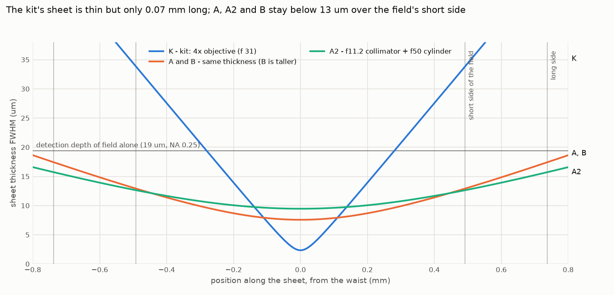
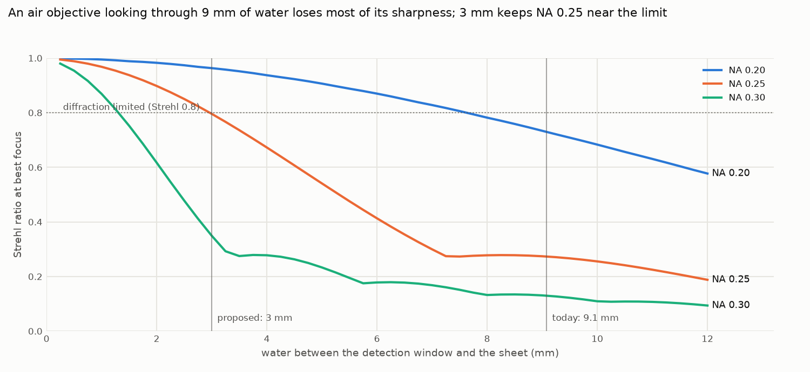
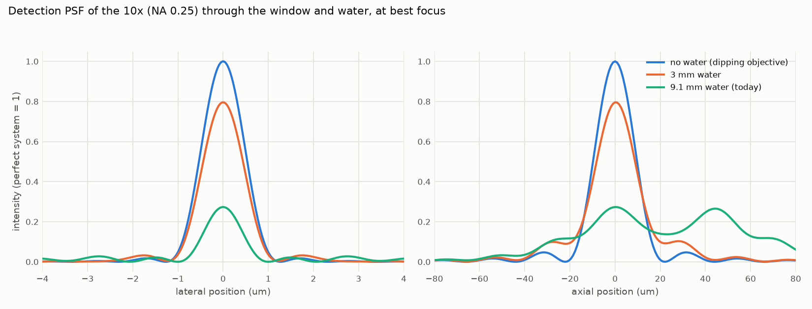
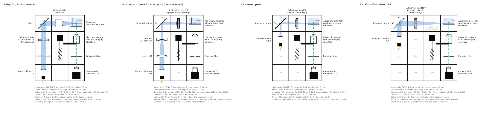

# openUC2 light-sheet microscope — round 1: simulation and arrangement

*2026-10-22. Optics only: no Inventor work in this round. Numbers come from
[`ls_optics.py`](../ls_optics.py) (all checks pass, `--validate`); the full tables are in
[`ls_numbers.md`](ls_numbers.md), the drawings from [`ls_layout.py`](../ls_layout.py).*

## 1. The ask

> We already have the light sheet microscope in our assembly, how could we improve the imaging
> quality with this while keeping the overall size and price as small as possible? Also what
> would be good samples and sample mounts? Can you arrange the modules in the drawing first we
> don't need to start working in inventor immediately we should first do some simulation maybe
> in optiland. […] single mode 488 nanometer laser coupled into a fiber with four micrometer
> core, a collimator, a cylindrical lens with 50 millimeter focal length, several lenses and if
> necessary also a better camera than the imx 178. […] in the end we want to cubify.

## 2. What exists today

Read from CAD-new (kit `KIT - LIGHTSHEET- LGTSHT-26-02`, `OST - 0002 - Light sheet`,
`ASS - 2052 - CUBAQU - V04`, the BUY parts) and the openUC2 docs:

| element | part | facts that matter |
| --- | --- | --- |
| laser + collimator | FluoBox laser: Bosion 488 nm, fibre FC/PC (PRT-2161 INSFIBHOL), f28 D16 lens (PRT-2102) | single-mode, 4 µm core; mode-field diameter assumed 3.6 µm → 4.8 mm collimated beam with f28 |
| cylindrical lens | ASS-2054 CUBLENCYL30x32F100 (LightSheet add-on) | 30 × 32 × 5 mm; the docs place its line focus in the pupil of the 4x |
| illumination objective | CoreBox 4x (`BUY - Objectiv 4x - XXX`) in ASS-2088 CUBRMSTHRMOV | NA 0.1 per the docs; focal length unknown (31 mm if DIN 160, 45–50 if infinity) |
| sample chamber | ASS-2052 CUBAQU with PRT-2058 INSAQU | 0.17 mm cover-glass windows: illumination window **11.08 mm**, detection window **9.08 mm** from the cube centre (the sheet) |
| detection objective | L Plan 10x (InfinityBox), RMS, on the electronic z-stage | nose 28.7 mm from the shoulder; NA 0.25 assumed (openuc2.com lists 0.3); design tube length 200 mm assumed |
| emission filter | ASS-2053 CUBREMOVAEMIFILWLS485 | in the infinity space |
| tube lens + camera | CLENS-100TEL f100 + HIK MV-CE060-10UM-PRO (IMX178 mono, 3072 × 2048, 2.4 µm) | 5x: 0.48 µm pixels, field 1.47 × 0.98 mm |
| sample | ASS-3006 AUTXYZSTG + ASS-4007 HOLPIP (syringe holder) above the aquarium; FEP tubes in the kit | sample moves in XYZ through the static sheet |

The sketch's arrangement is **K** below.

## 3. What the simulation says

### 3.1 The kit's sheet is far too short for the camera field

With the 4.8 mm beam in the pupil of the 4x, the sheet NA is 0.078 (f31) or 0.054 (f45): a
2.3–3.4 µm waist that stays thin over only 0.07–0.14 mm. The camera sees 0.98 mm along the
sheet (its short side). At the edge of that side the kit's sheet is **34 µm** (f31) or 23 µm
(f45) thick, thicker than the detection's own depth of field (19 µm at NA 0.25), so most of
the image gets no optical sectioning at all. Two more symptoms of the same design: the 4x has to
sit 16 mm closer to the aquarium than its cube centre (the docs' "modified" 4x), and with an
f45 4x the cylinder cannot put its line focus into the pupil from inside its cube (43 mm off).

A sheet NA of 0.024 matches the field: **7.6 µm** at the waist, **12.9 µm** at the short edge,
0.71 mm long. At that NA no objective is needed: one cylindrical lens focusing straight into
the aquarium does it (its aberration is 1–4 % of the waist in the real-ray trace).

### 3.2 Imaging through 9 mm of water costs most of the detection's sharpness

The 10x is an air objective looking through the 0.17 mm window and 9.1 mm of water. Water
adds spherical aberration that grows with its thickness and with NA⁴ (Optiland and the
textbook formula agree within 3 %). After refocusing:

| water path | NA 0.20 | NA 0.25 | NA 0.30 |
| --- | --- | --- | --- |
| 9.1 mm (today) | Strehl 0.73, 2 µm modulation 0.20 | **0.27, 0.10** | 0.13, 0.04 |
| 3 mm | 0.96, 0.23 | **0.80, 0.30** | 0.35, 0.11 |
| 2 mm | 0.98, 0.23 | 0.90, 0.34 | 0.62, 0.25 |
| perfect | 1.00, 0.24 | 1.00, 0.37 | 1.00, 0.47 |

"2 µm modulation" is the contrast of a 2 µm grating in the image. Today a 2 µm structure comes
through with 10 % contrast instead of 37 %, and a point's peak signal is a quarter of what the
objective can give. Bringing the window to 3 mm from the sheet triples the peak signal, which is
more than any camera swap gains. Until then, closing the InfinityBox's SK23 iris to NA 0.20
doubles the contrast (0.20 instead of 0.10).

### 3.3 The camera is not the bottleneck

IMX178 behind the f100 tube lens gives 0.48 µm pixels: Nyquist for NA 0.25 at 520 nm (0.52 µm),
and the largest field (1.47 × 0.98 mm) of the sensors compared in [`ls_numbers.md`](ls_numbers.md).
Larger pixels need a longer tube lens for the same sampling, which shrinks the field again.
A new camera helps only if the images are photon-limited after the fixes above; then pick it for
quantum efficiency and read noise at the same 0.5 µm sample pixel.

### 3.4 Resolution along the detection axis, whole system (NA 0.25, 3 mm water)

| arrangement | at the waist | at the field's short edge (0.49 mm) | at 0.74 mm |
| --- | --- | --- | --- |
| K (kit) | 2.4 µm | 17.7 µm | 19.2 µm |
| A, B | 7.1 µm | 11.0 µm | 13.4 µm |
| A2 | 8.6 µm | 10.8 µm | 12.6 µm |

## 4. What to change, ranked by effect per cost

1. **Detection window 3 mm from the sheet** (today 9.1). A new insert for ASS-2052 with a
   deeper detection pocket: the objective's nose moves from 18.6 to 17.1 mm from the sheet, so
   it reaches 7.9 mm into the aquarium cube (today 6.4). Use 4 mm (Strehl 0.66) if a 4.7 mm
   agarose cylinder must scan ±0.5 mm in front of the window. Meanwhile: iris to NA 0.20.
2. **Sheet NA 0.024 without the 4x**: arrangement A, A2 or B. All three keep the sheet below
   13 µm over the field's short side.
3. **Laser blocking of the emission filter.** The sheet's scatter goes straight into the
   detection objective; check the background with the laser on and no dye. If it is visible,
   a band-pass around 525 nm with OD 6 at 488 nm is the cheapest image-quality gain left.
4. **Alignment that holds**: kinematic mirror for the sheet's tilt (keep it within 0.2°), a
   rotatable cylinder holder (sheet parallel to the focal plane within 0.15–0.3°), waist on the
   field centre (slide the cylinder; 1 mm moves the waist 1.34 mm in water), camera turned so its
   short side lies along the sheet.
5. **Stripes** (dark streaks along the sheet behind absorbing structures) are shadows, not a
   coherence effect: a single-mode beam cannot be "wiggled" incoherent. Remedies, cheapest
   first: image from the side facing the region of interest, destripe in software, rotate the
   sample for multi-view (CAD-new already has a rotating FEP insert,
   `20_Cube_Insert_Lightsheet_FEPTube_Rotating_hollomotor_v0`), illuminate from both sides.
6. **Camera** last, see 3.3.

## 5. The arrangements

| | K (today) | A (recommended) | A2 | B |
| --- | --- | --- | --- | --- |
| footprint | 3 × 4 | 3 × 4 | 3 × 4 (two cells free) | 4 × 4 |
| illumination | f28 collimator, f100 cylinder into the 4x pupil, fixed mirror, 4x | f28 collimator, CoreBox f100 + f−50 (2:1 reducer), kinematic mirror, f50 cylinder | f11.2 fibre collimator, kinematic mirror, f50 cylinder | f28 collimator, kinematic mirror, kit's f100 cylinder turned 90° |
| sheet waist / length / height | 2.3 µm / 0.07 mm / 1.5 mm | 7.6 µm / 0.71 mm / 2.4 mm | 9.5 µm / 1.11 mm / 1.9 mm | 7.6 µm / 0.71 mm / 4.8 mm |
| brightness at the field's long edge | 14 % | 47 % | 31 % | 83 % |
| new parts | – | holder for the f50 cylinder, aquarium insert | collimator holder, cylinder holder, aquarium insert | aquarium insert |
| freed | – | the 4x objective | the 4x, f28 lens | the 4x |

Per cell, with CAD-new names: `layouts/<key>/ls_layout.json`. All arrangements put the cylinder
2.9 mm behind its cell centre (the water shifts the focus), within the insert range. A and A2
need the long side of the field cropped or the sheet height accepted (47 % / 31 % at the long
edge); B gives a uniform full field at the price of a fourth column (fits the kit's 4 × 5 plate).
The XYZ stage with the syringe holder stands above the aquarium in all of them (not drawn).

## 6. Samples and sample mounts

**To calibrate** (do these first, they check every number above):
- fluorescein water (a highlighter tip) to see the sheet from the side and put its waist on the
  field centre (the docs' method);
- 0.2–1 µm green fluorescent beads in 1 % agarose: lateral and axial PSF, sheet thickness by
  scanning, field flatness.

**Easy specimens at 488 nm**: pollen (bright autofluorescence, 20–100 µm 3D shapes); small
insects (fruit flies, springtails, ants: autofluorescent cuticle; the docs recommend them for
training); plant seedling roots (cress, Arabidopsis, GFP lines if available); moss leaves and
algae (chlorophyll emits red: needs a long-pass filter above 600 nm); C. elegans and zebrafish
embryos or larvae with GFP lines; spheroids or organoids stained with Calcein-AM; nuclei with
acridine orange or SYTO 13. Cleared tissue in ethyl cinnamate (the SLA chamber that exists)
needs its own aberration check: per millimetre it aberrates about 15 % more than water.

**Mounts**:
1. Agarose cylinder extruded from a cut 1 ml syringe (docs: 1.5 % agarose; 0.5–1 % low-melting
   for live specimens). Put the region of interest on the detection side of the cylinder.
2. FEP tube (refractive index 1.34, almost invisible in water; in the kit and ASS-2038
   CUBFEPTUB) with the specimen in 0.1–1 % agarose or methylcellulose: the gentlest mount for
   live embryos and larvae, and the thinnest (best with the 3 mm window).
3. Glued to a pin (the docs' M5 set screw) for insects, seeds and fixed tissue; superglue, not
   Blu-Tack.
4. Rotation: the existing hollow-motor FEP insert for multi-view stacks.
5. Keep the magnetic quick-change plate on the XYZ stage (docs).

## 7. Model and checks

- Sheet: Gaussian beam per axis (ABCD), fibre mode → collimator → lenses → window → water;
  the focusing lens is moved until the waist sits on the aquarium centre.
- Optiland 0.6.3, unfolded paths (the fold mirror is left out): real-ray focus of the thickness
  fan agrees with the Gaussian waist within 0.07 mm, the sheet height within 0.4 %, for the five
  arrangements K, A, A0, A2 and B.
- Detection: object point in water → window → perfect objective → tube lens; Zernike fit of
  the wavefront; primary spherical aberration equals the textbook value within 0.4–2.5 %;
  without water and window the residual is 2e-5 waves; the PSF from the fitted pupil
  reproduces the ideal lateral (1.07 µm) and axial (19.5 µm) FWHM.
- Lateral sharpness is reported as modulation, not FWHM: with strong spherical aberration the
  core of the PSF gets narrower while the energy goes into the rings, so a FWHM looks better
  than the image is.
- Exported stand-alone Optiland scripts: `layouts/<key>/ls_illumination_<key>_{thickness,height}_optiland.py`,
  `layouts/ls_detection_water{9.08,3}mm_optiland.py` (each draws itself into a PNG).

## 8. Choices made in this round and open questions

Choices (change them in `ls_optics.py`, the tables follow):
- Fibre mode-field diameter 3.6 µm at 488 nm; collimator f28 as named (its CAD radius R20
  would give f 38.7 in N-BK7: measure the beam, a 6.7 mm beam would make the sheet 1.4x
  thinner and half as long).
- The user's f50 cylinder modelled as N-BK7, R 26.1, 5 mm thick, curved side to the fibre.
- 10x: NA 0.25, f 20 (200 mm design), working distance 16.3 mm.
- Water path target 3 mm; sheet on the cube centre; camera short side along the sheet.

Questions (recommendation first):
1. Which arrangement goes to cubify? **A** (same footprint, only CoreBox parts plus two
   printed holders), B if the full field must be evenly lit.
2. Which collimator is "a collimator" — the FluoBox f28 lens or a separate fibre collimator
   (its focal length)? With f ≈ 11 mm, A2 drops two cubes.
3. The 10x: NA 0.25 or 0.30, and its design tube length (180 or 200)? At NA 0.30 the window
   must come to 2 mm, or the iris stays at 0.25.
4. May the new aquarium insert put the detection window 3 mm (FEP tubes) or 4 mm (syringe
   cylinders) from the sheet? The objective then reaches 8 mm into the aquarium cube.
5. Is the f50 cylinder 30 × 32 mm like the kit's f100 (for its holder), and should its holder
   rotate by hand or with a fine screw?
6. Emission filter: what is the WLS485/WLS488 filter's blocking at 488 nm?

## 9. Sources

- openUC2 docs, light-sheet add-on: https://docs.openuc2.com/usage/disc/lightsheet-addon/Light_sheet_Fluoresence_microscope/
- openUC2 docs, light-sheet sample tips: https://docs.openuc2.com/usage/disc/lightsheet-addon/LightSheet%20Sample/
- openUC2 shop, light-sheet add-on: https://shop.openuc2.com/shop/discovery-light-sheet-add-on-154
- openUC2 InfinityBox: https://openuc2.com/infinity-add-on/
